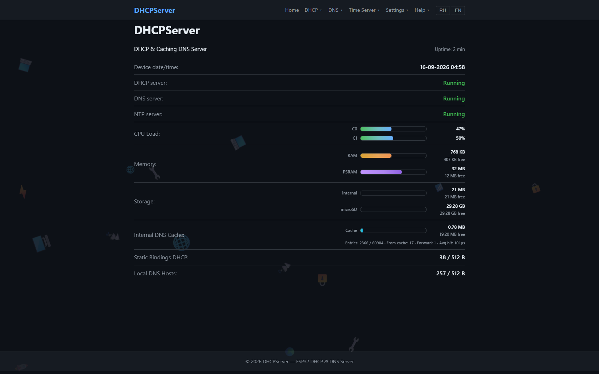
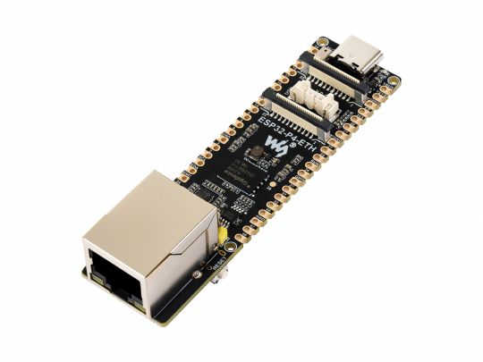

# DHCPServer

**DHCPv4 + Caching DNS Proxy + NTP Server for Waveshare ESP32-P4-ETH**

---



---

## 📖 Description

DHCP server and caching DNS proxy built on the **Waveshare ESP32-P4-ETH** (dual-core RISC-V **ESP32-P4**). The device connects to the local network **over the onboard 10/100 Ethernet** (internal EMAC + **IP101GRI** PHY) — **WiFi/Bluetooth are not available on the ESP32-P4**. It assigns IP addresses through DHCP, proxies DNS queries with caching and logging, serves time over NTP (and syncs its own clock from an upstream NTP server), is managed through a web interface (dark theme, RU/EN localization) that also offers a **file explorer** for the internal FAT data partition and a microSD card, or through a UART terminal menu.

---

## ✨ Features

- **DHCPv4 Server** — configurable IP range, subnet, gateway, lease time, static MAC→IP bindings (enable + per-host DNS override). An address a client refuses is **held back** (RFC 2131): a `DHCPDECLINE` means that client probed the address and somebody answered, which is better evidence than the server's own probe — the very probe that had just missed — so the address leaves the pool for an hour (`DeclinedAddresses`), a lease the refusing client held on it is dropped, and a later REQUEST for it is answered with a NAK instead of an ACK. Before that, one client that was offered an address already held by a machine that did not answer ARP replayed OFFER/ACK/DECLINE every 15 seconds, indefinitely. What the server does with a client can also be kept in a **file of its own** on the internal volume — `/fat/logs/Dhcp.log`, the same lines the terminal shows, archived to the microSD card as `log/Archive/Dhcp/<first day>-<last day>/Dhcp.log` when it is full, with its own switch and its own size (64 KB by default, 128 or 256 KB) on the DHCP ▾ Logging page
- **Allowed Computers (DHCP allow-list)** — "assign addresses only to allowed computers" (DHCP ▾ General): with the switch **off** the list is ignored completely and addresses are handed out as before; with it **on** a client is served only when its MAC is in the list (≤ 25 entries, per-entry Enable checkbox, 1024-byte NVS budget) or when it has a static binding whose own Enable checkbox is on — every other machine gets nothing at all, so it loses its address at the next renewal instead of being refused politely. The list is mirrored into a PSRAM MAC hash table (built at boot, rebuilt on every save, lock-free swap, listens nothing) and the policy **fails open** if that table cannot be built, so a memory failure never takes the LAN off the air. Part of the settings export/import, and the page says which state the list is in. The page itself lives under **Settings ▾ → Security → Allowed computers** (it lives there together with a proper name for the file: `security_allowed.html`)

Messages on that page (the list is full, a row has a name but no address, the device refused the save, the list was saved) are shown by the page's own dialog, not by the browser: a browser alert cannot be translated, styled or captured in a screenshot, and it blocks the whole page. A message has exactly one answer, so its dialog has a single button.

Every page of the interface works that way — a device refusal, a saved message or a question is drawn by the page itself, in the language the operator picked, and there is no browser `alert()` or `confirm()` left anywhere. A refusal is shown with `common.error` as the title and the device's own words underneath. **A device that does not answer at all is a refusal of the same kind**: the settings pages ask before they draw, so a request that never arrived is answered with `common.save_failed` ("Could not save — the device did not answer"), the switch the operator had just moved goes back where it was and the block below it is rebuilt — a half-changed screen that disagrees with the device is what the operator used to be left with when the connection dropped mid-save. The same dialog also carries **input**: where an action needs more than a yes/no, it opens with a text field, a drop-down or both (`showFieldDialog()` in `data/js/app.js`), so a question is asked where the button is, not by a row of controls that the operator has to notice on the page before pressing it (the name and the validity of a new certificate).

The line under the table counts the entries and, when some of them are switched off, how many of them are enabled; it follows every edit that can change the number, the Enable checkboxes included.

On the page itself a row without a MAC is **not an entry**: its Enable checkbox is off (it goes off by itself if the address is erased), it is not counted, never saved, and a half-filled row (a name with no address) stops the save with a reason instead of making the device refuse the whole list
- **DNS Proxy** — pipeline: logging → local hosts → **internal (PSRAM) cache** → external cache (REST) → forwarding to external DNS. The answers that came from outside can be kept in a **file of their own** on the internal volume — `/fat/logs/Forwarded.log`, one line per answer with the local time of it — archived to the microSD card as `log/Archive/Dns/<first day>-<last day>/Forwarded.log` when it is full, with the size chosen on the page (64 KB by default, 128 or 256 KB). That file has its **own** switch and its own `Forwarded` filter, separate from the terminal's: the operator may want the terminal quiet while the file keeps the record
- **Block non-A/AAAA forwarding** — optional toggle on DNS Setup: queries of any type other than A/AAAA that are not answered from local hosts get an immediate NODATA reply and are never sent to the external cache/upstream (the client falls back to A/AAAA)
- **Internal DNS Cache** — on-device A/AAAA hash table in PSRAM (up to 20 MB, configurable; TTL-aware, ignore-TTL option), served before the external cache. Every record carries a **usage counter**: it grows by one for each answer served from the cache and for each answer stored, the **least used** record is evicted when the pool fills up, and the status reports the total and the most-used name (the cache file keeps the counters, format version 3; version 1 and 2 files are still read). The status line prints the average hit time next to the parts it is made of — waiting for the arena lock, the cache's own work, and the number of records a hit walked (those totals survive a reboot with the statistics file, and so does the count of hits they are divided by, so a restored "wait" and a restored average describe the same traffic)
- **Cache View** — the records the cache holds **right now** can be looked at, on a page of its own opened by the **Cache view** button under the Statistics block of the Internal Cache page (the page opens **in the same tab**; the **✕** goes back to the Internal Cache page, taking the step back rather than a fresh address, so that page is as it was left). A pool holds tens of thousands of records, so the page shows **one page of them at a time** (100 by default, 200 at most) with a pager that walks anywhere — **First / Previous / 1 2 3 … 99 / Next / Last** — and two filters that narrow the walk: a **name** (a substring, so `ample.co` finds `www.example.com`) and a **type** (`A`/`AAAA`/both). Every column a record has is there: name, type, the address it answers with, its TTL, the time left, its age and how many answers it has served — the three columns that are times say their unit **in the header** (`TTL (s)`, `Left (s)`, `Age (s)`, with `(с)` in Russian) and their values are plain numbers, and the headers of `Left` and `Age` are centred so a unit that does not fit beside its label sits under it; a name longer than the reference 28 characters is cut and ended with `...` (the whole name stays in the cell's tooltip, and every action uses the whole one), the addresses of a record are listed one per line (the table is laid out to fit the card — fixed column widths, with a long value wrapping inside its own cell, because an address column left to size itself pushed the last column off the card), a record held past its TTL is marked `expired` (with "Ignore TTL" on that is the normal state, not a fault) and one with a TTL of 0 never expires. The records can also be **removed** from here: a checkbox column ticks them (with a "tick every record on this page" box in its header), and the **⋯** menu's **Delete** forgets the ticked ones — a record is named by name *and* type, so the device is asked once per record and the count that comes back is shown; **Clear cache** forgets all of them. What is removed here is removed from the cache in PSRAM, never from the file on the card
- **Cache Persistence** — the built-in cache can be saved to/loaded from `cache.dat` on the FAT partition (background job with live progress; auto-restored on boot), and a planned restart no longer throws the working set away: with the "Save cache before reboot" switch on (**default**, in the cache block of the Internal Cache page, while "Save statistics before reboot" has a **Statistics** block of its own below it) the device writes the whole table before restarting — from the Reboot button, a firmware update or the console's `reboot` — and loads it again at boot; every save also stores an **MD5 of the file** in NVS, and a file whose checksum does not match is refused (the boot restore logs it, the load button asks before overriding). A restart does not take the write on trust either: the statistics file is read back and compared byte for byte, the cache file is parsed and its record count compared with the one the save reported, and a file that does not match is written **once more**. If it still does not match, the page says so with the device's own words and asks the operator — "cancel the reboot/update" or "go ahead anyway" — while a path without a page (a script's OTA upload, the terminal's `reboot`) writes the reason to `Errors.log` and carries on. The page also says **which of the two things the device is doing, and which file**: the write and the read-back are separate phases of the progress it polls (`checking`), the file is named by its path (`path`), and a finished read-back that matched is reported as such (`checked`, which is not the same as a successful save — the DNS page's own button writes without checking). So the status line reads "Saving the cache: /fat/cache.dat… 30 %", then "Checking the cache file: /fat/cache.dat… 70 % (700 / 1000)", then "The cache file was checked successfully.", then "Cache saved."; the statistics file gets the same four lines (`/fat/Statistica.dat`), with its "checking" line rarely visible because 92 bytes are read in microseconds — the step line names both halves while the job runs. Every one of those lines stays on screen for **at least two seconds** before the next one takes its place, including the last one of the sequence (the wait happens before a replacement, not after it), so none of them flashes by unread
- **Statistics File** — the numbers of the main page (From cache / Forward / Avg hit) live across a restart in `/fat/Statistica.dat` (one 92-byte record), and that file has the same three buttons the cache file has, in the **Statistics** block of the Internal Cache page: **Save to file** (the same background job the reboot path uses, with its verdict on the page), **Load from file** (the counters are replaced by what the file holds — the same numbers, through the same code the boot restore uses) and **Reset** (the counters are zeroed *and* the file is deleted, because a zeroed device that kept the record would read it back at the next boot). The switch next to them, "Save statistics before reboot", is about the **automatic** writes only: a save the operator pressed himself happens whether it is on or off. The block also has an **Autosave** of its own — its own switch, its own period (one day by default) and a **Next update in** countdown, exactly as the cache's autosave above it has, because the two write different files: the statistics are 92 bytes and the cache is megabytes, so the operator asked for the block that keeps the counters to look after its own file
- **Cache Reset and Autosave** — the Reset button of the Internal Cache page
  drops every cached answer held in PSRAM (the file on the card is left
  alone); the cache can also save itself every N minutes, N hours or N days —
  **one day by default** — the interval being bounded by its unit (60 minutes,
  24 hours, the length of the running month in days) and applied by the Save
  button next to it, with a **Next update in** countdown under it while the
  switch is on. The autosave is suspended while the clock is not set, and a
  manual save shifts the countdown by a whole period.
- **Cache Auto Update** — with **Ignore TTL** on, the built-in cache can also
  refresh itself from the upstream DNS: every N hours or days one **sweep** walks
  the whole cache in blocks of "Max entries per update", pausing "Pause after
  update (sec)" **between** the blocks rather than after every single record
  (pausing per record turned a 50-record block into 50 minutes). Inside
  a block the records whose last refresh failed come first, then the oldest in the
  pool, and a record the upstream confirms is written back with a fresh TTL (one
  it does not confirm is kept, and the next sweep retries it first). The period
  counts **between sweeps**, so a 2000-record cache is refreshed in one go instead
  of 40 records per period. The Auto Update block
  appears only while Ignore TTL is on, and a running sweep is listed on the
  Task Scheduler page — with the whole cache as its total, not one block — where it
  can be stopped: the sweep ends within a second, even while it waits between two
  blocks, and **the setting is left exactly as it was saved** — the scheduler's
  Stop ends an operation, and the switch on this page is the only thing that turns
  Auto Update off. (The cache autosave keeps the opposite rule on purpose: its
  write is one call into the filesystem that cannot be interrupted, so a stop
  there means "no more automatic saves" and switches it off.) Waiting
  between two blocks, that
  row says so itself: its state badge reads `paused` with the seconds left in it
  (`paused 60 s`, counting down), instead of sitting there as a frozen
  `running` for the whole pause. Under "Update every" the page shows **how long is left** as `Nd HH:MM`
  (days, hours, minutes): the device reports its own countdown
  (`GET /api/dns/internal-cache/autoupdate`), the page ticks it locally and
  re-reads it every few seconds, says "updating…" while a cycle runs and keeps
  the line away entirely until the clock is set (a frozen number would be a
  lie). A sweep can also be asked for by hand: **Update now**, on a
  line of its own above Save, starts a full sweep at once instead of waiting
  the period out — it is blocked and labelled "Updating…" while a cycle runs,
  works even when the clock is not set (a countdown needs the time, one
  asked-for sweep does not), and re-arms the countdown afterwards, so the next
  scheduled run is a whole period away. The device refuses in its own words
  (shown in the dialog) when there is nothing to sweep: Auto Update off, Ignore
  TTL off, no internal cache, or a cycle already running. Every record a cycle
  walks is written to a **log of that sweep's own, on the microSD card**:
  `<card>/log/AutoUpdate/2026.10.11_01.34.log` — the file is named after the local
  time the sweep started and holds the **whole** sweep (~5 MB for 59520 records,
  tens of thousands of lines), so a sweep is not cut down to its last few hundred
  lines the way a 64 KB cap would cut it. A line reads
  `[2026-10-05 05:12:33] cache_autoupdate: example.com A refreshed (ttl 300 s)`,
  or `… not confirmed, record kept` when the upstream did not answer; the journal
  `Jobs.log` keeps only the two ends of the cycle. Ten newest sweep files are kept
  (older ones go as a new sweep starts), and the file is there under two
  conditions, each answered in `Jobs.log` instead of silently: **a mounted card**
  and **a set clock** — `1970.01.01_00.00.log` would be a lie, and "Update now"
  is allowed without a synced clock. On a build with no card slot (the classic
  ESP32) a sweep writes no per-record log at all
- **Time Server (NTP)** — the device syncs its clock from an external NTP server (SNTP) and serves UTC time to LAN clients over NTP (UDP 123; configurable external NTP servers — up to three names in one field, separated by a comma or a semicolon, by default a pool of three different operators (`pool.ntp.org, time.google.com, time.cloudflare.com`), with the client moving to the next one when a server stops answering, which is what keeps one dead node in a public pool from leaving the device without a clock — a **Check** button beside the field asks those servers on demand and reports who answered, to what address and with which stratum, or that a name did not resolve or nobody replied in three seconds; re-sync interval with a countdown to the next one ("Next sync in", counted from the last confirmed answer in uptime seconds, so correcting the clock cannot move it), named timezone selection with a custom-offset fallback; clock sync and serving can be switched on/off independently, and the block of the serving switch also carries the two filters that narrow **who** is answered — **Allow only own subnet** and **Only allowed computers** — both of which appear only while serving is on, since neither means anything while the server is off; the page offers **Reset to default** at its bottom — outside the cards and only while its own settings (server, timezone, offset, interval, reply limit and the four switches) differ from the factory ones, in which case the device puts its defaults back and applies them at once, leaving the logging settings alone; optional logging of served requests to the terminal, to a file, or to an external REST service — the file is `/fat/logs/Ntp.log` with seconds and the device's local time, archived to the card as `log/Archive/Ntp/<first day>-<last day>/Ntp.log` when it reaches the chosen size (64 KB by default, 128 or 256 KB, picked on the page), with the last ten lines carried into the new file when there is no card and ten reported attempts before giving up when the card refuses the write; requests the server could only answer with "the clock is not trustworthy" are recorded there as well, marked with the stratum the client was told, which is what makes the file useful while the device itself cannot synchronise; the same file also carries the device's **own** attempts — the client starting and stopping, every successful synchronisation with an estimate of how far the clock was off, a manual clock setting, and a "still not synchronised" line that repeats at most three times a minute apart, then every 2, 5 and 10 minutes, so that a device which cannot synchronise says so itself without filling the volume; those lines also say *why* it may never come — the client start writes the resolver chain (`resolver: this device (192.168.0.10), upstream 192.168.1.1, gateway 192.168.0.1`), each "still not synchronised" line carries a verdict for the first server of the list (`DNS -> <address>`, `DNS lookup failed`, or `DNS lookup still pending` when there was no result to report), and the device probes the servers itself on the same beat and names every one of them with who answered: `NTP probe: pool.ntp.org (51.250.53.172) - no reply in 3 s; time.google.com (216.239.35.8) - replied (stratum 1); time.cloudflare.com - not asked (an earlier server replied)`). **The saved offset is the device's own clock**: applying the time settings sets the system's `TZ` from `utc_offset_hours` (POSIX form, so UTC+3 is `UTC-3`), which is what makes the pages, the `Errors.log` / `Jobs.log` stamps and the name of a sweep's log file show the same time — before that the logs were silently in UTC while the pages showed local time. The zone *name* stays display-only (newlib would need the tzdata of a named zone, which this build does not carry) and daylight saving is not modelled: the saved offset is the one in force. Until the clock has been synchronised (or set by hand) the server answers with LI=3/stratum 16 (RFC 5905) instead of a wrong time. The date/time can also be **set manually** from the web interface — typed in the selected timezone or taken from the computer's clock, and values earlier than the firmware build time are refused (the board has no battery-backed RTC)- **LAN-only hardening** — the built-in DNS and NTP servers answer only clients from the device's own subnet (**on by default**; a query from outside is dropped without any reply, so the device cannot be used as an open resolver or a reflection amplifier). The NTP server can be narrowed further, per computer: with **Only allowed computers** on it asks the DHCP side who owns the address a request came from (the lease table, then the ARP cache, then an enabled static binding) and answers only a computer that is on the allowed list or covered by a binding — an address nobody owns gets no reply, which is the strict form of the rule, so a computer with a hand-set address that neither list mentions receives no time. The **file explorer applies the same rule** to `/api/files/*` (a foreign client gets `403`). NTP additionally rate-limits replies per client address (1..100/s, default 5), and the DHCP lease/offer table has a hard cap (`0` = auto = 2× the pool size, 8..512, configurable) so a DISCOVER flood with random MACs cannot grow it without limit
- **File Explorer** — browse, download, upload, rename, delete and format the **internal FAT data partition** (~21 MB, `/fat`) and a **microSD card** in the board's slot (`/sdcard`; no card is fitted by default, so that volume reports “not mounted”). A card is picked up **and noticed again** while the device runs: a missing one is retried (at most once every few seconds), and a mounted one is asked on the bus whether it is still there (no card-detect line exists on the board), so pulling it out flips the volume to “not mounted” within a poll instead of reporting yesterday's capacities until the next reboot. One “⋯” button on the right holds the file actions (**New file**, **New folder**, **Select all**, **Upload file**, **Upload folder**, **Move ...**, **Delete** for the ticked rows, **Refresh**, **Format volume**, **Check for errors**) and a **read-only volume check** walks the whole volume, reading every file to the end — a broken cluster chain is only visible that way — then offers the two actions that can make a card usable again (delete the unreadable entries, or format it; the deletion is a device job of its own — **Damaged-entry removal** on the Task Scheduler page, stoppable there — that repeats its passes until a walk comes back clean, since one report names at most 64 entries). Formatting also works on a card that cannot be mounted (an interrupted format leaves one without a filesystem, and the format is the only thing that can give it back), and a card that stopped answering mid-format can be brought back by stopping the operation: its supply is cut for five seconds, which breaks the stuck driver call. The same button formats the **internal volume**, which holds only generated data (the journals and the DNS cache file) while the settings live in NVS: on this build FatFs speaks the ANSI/OEM code page, so an entry whose stored name does not survive that code page cannot be unlinked at all — it cannot even be looked up — and a format is the one thing that clears it. Rows have their own menu (download/open/rename/delete). Uploads are atomic (`<name>.part` + rename) and **resumable**: the progress row carries pause and cancel buttons, and a paused (or interrupted) transfer continues from the byte the device reached instead of starting over — the temporary `*.part` names stay hidden from the explorer and cannot be created through the API. Text files can be edited in the browser — with a **Reload** button beside **Close** that reads the file from the device again, which is how an outside change reaches the editor and how a save that was refused because the file had changed on the volume is tried again; the field is not overwritten while it holds unsaved edits (that is asked first, and the status line says whether the file had changed on the device), and the home page shows both volumes’ used/free space next to the RAM bars
- **Onboard Ethernet 10/100** — internal EMAC + IP101GRI PHY over RMII (no WiFi — ESP32-P4 has no radio)
- **Task Scheduler** — every long-running operation of the device in one list (Settings ▾ Task Scheduler): volume check, file uploads, DNS cache writes, formatting, connection tests. Each operation gets its own block with its state, progress **in the unit the operation itself reports** — bytes for a copy, records for the cache jobs, and no number at all for an operation that measures nothing (the page used to append `B` to everything and read a 50-record cache sweep as `4 B / 50 B`) — an indeterminate bar while the total is unknown, the file or volume it is working on and the elapsed time, and **any unfinished one can be stopped from there** — the list only holds operations that are still running or waiting, so there is no "stoppable" flag to consult and no dead button (a paused upload drops its `.part`, a check ends at its next entry, a **format even on a card that stopped answering**: the operation ends at once and the card's supply is cut for five seconds, which breaks the stuck call). The firmware keeps the list (`core::JobRegistry`), so a subsystem only has to announce itself — a finished one-off operation leaves the list at once, and one scheduled to repeat stays with its interval. **Long operations run outside the web server's task**, so a card that takes minutes to erase, a multi-gigabyte upload, or a large download does not freeze the interface for anyone else (in a second browser the pages and the `/api/status` polling keep working). The list answers "what is running *now*" and a reboot wipes it, so every operation is also written to **`/fat/logs/Jobs.log`**: one line when it starts and one when it ends, with its result and how long it took — `[2026-10-04 02:06:43] job: file_check (sd): finished (done, 12.3 s)`. The file is read in the File Explorer like any other, is capped at 64 KB and, when full, is copied to the microSD card as `log/Archive/Jobs/<first day>-<last day>/Jobs.log` (the same policy every file log of this device follows, with the newest ten lines kept when there is no card), and progress is deliberately never logged — an operation reports its percentage dozens of times, and the file would drown in it
- **Web Interface** — dark theme, RU/EN localization, DHCP/DNS/Time/Security sub-pages
- **Device Host Name** — the name the device answers to on the network is set on **Settings ▾ General** (default `DhcpServer`), checked as an RFC 1123 label (1–63 letters, digits or hyphens, neither end a hyphen), kept in NVS, carried in the settings backup and applied to the network interface the moment it is saved — no reboot, and the page never says there is one. A switch of its own publishes that name: the built-in DNS answers `<hostname>` and `<hostname>.local` with the device's IPv4 and IPv6 addresses (so clients that take this device as their DNS server open it by name), an mDNS responder publishes `<hostname>.local` for Windows 10+/macOS/Linux clients that use another DNS, and an **SSDP/UPnP** responder advertises the device on the LAN so it can appear in Windows' device list — the mechanisms share one switch, which is on by default. The UPnP description is public (a discovery client cannot be told a password) and stays reachable over plain HTTP even while HTTPS redirects everything else. WS-Discovery — what Windows' own "Network" folder uses to find computers — is a separate mechanism and not part of this build
- **Device Log** — what the **device itself** did, kept where it can be read from the web interface: `/fat/logs/Device.log` opens with the start of a run and the firmware version, names in the same line why the previous run ended when that was not a power-on (`a panic (the firmware aborted)`, `the task watchdog`, `a brownout (the supply dropped)`, `a software restart`), records a restart asked for from the **web interface**, the **console** or an **SSH session**, a **factory reset** with what it erased, and a **settings import**. It is the file that answers "did this box crash while I was not looking" without a UART cable, and it is separate from `Errors.log` on purpose: a planned restart is not an error. A full file is archived to the card as `log/Archive/Device/<first>-<last>/Device.log` (with no card the newest ten lines stay). Its switch and its cap (64, 128 or 256 KB) are on **Settings ▾ General** for now, both applied live. When the previous run ended in a crash, the file also says **where** the SSH server died — the step is kept in RTC memory, which survives the panic that no file write survives — and libssh's own protocol lines (`libssh ssh_kex2: …`) are written here too, because a panic inside the key exchange leaves the library as the only witness
- **HTTPS and Certificates** — the interface can be served over **TLS (port 443)** as well as plain HTTP (80), switched live from **Settings ▾ Security** and refused with a reason when no usable pair is stored. While TLS is up **and** the stored pair has not expired, the plain port stops serving altogether and answers **every** request — pages, files, `/api` and even an unknown path — with a **permanent redirect** to the same address over `https://` (`301` for GET/HEAD, `308` for anything else, so a POST keeps its method and body); the name in the answer is the one the client asked for (`Host`), so `http://dns.lo/pages/files.html` lands on `https://dns.lo/pages/files.html`. It switches itself **off** with the pair: the moment the certificate expires, and whenever TLS is off or no pair is usable, the plain port serves again — and the device's own IP stays reachable both ways, since the redirect is the same for every name The pair itself lives on **Settings ▾ Security → Certificates**: the volume it sits on (internal FAT or microSD, with the offer to **copy** it when you switch), a self-signed **ECDSA P-256** certificate generated on the device (name typed by the operator and **remembered on the device**, default `dhcpserver.local`, plus the device's own IP as SAN; validity chosen from **1, 2, 3, 5 or 10 years**, 5 by default) — both asked for **in the dialog of the Create button**, which pre-fills the remembered name and period, follows every keystroke with the sentence that is about to be issued and warns that an existing pair will be replaced — the state of the pair in words (ready, no certificate, volume not mounted, unreadable, expired, not valid yet), the days left (warned about under 30) and three actions: create, **download the certificate** and delete. The **private key is never downloadable** — no route hands it out. A switch the boot could not honour yet is **not lost**: the certificate cannot be judged before the clock is set, so a stored "on" with a pair that reads as *not valid yet* is retried by the device itself as soon as SNTP — or a manual clock setting — provides a date, and `https_enabled` reports what is **listening**, not what is remembered. A client that connects and then says nothing cannot hold the interface for long: the TLS handshake runs on the same task as the handlers, so its timeout is set explicitly (`kTlsHandshakeTimeoutMs`, 3 s — a real browser on the LAN finishes in about 0.3 s, and the IDF default is 10 s), and the socket read/write timeouts are written out where the rest of that policy is
- **REST API** — full device management over HTTP with Basic auth + rate limiting. The login counts **one client's** wrong passwords towards the lockout: the peer address of the connection keys the counter — read from the socket, never from `X-Forwarded-For`, which a client could rotate to get a fresh budget on every request — and a request carrying **no** `Authorization` header is not an attempt at all, because it is the first half of the Basic challenge the browser is required to make. Before that fix a missing header counted as a failure while every client shared one hard-coded address, so five page loads from one browser locked the whole web interface out for everybody. That address is read in **both** families the board's server can report, and an IPv4 client is named by its IPv4 address: the HTTP listener is a dual-stack socket, so an IPv4 peer arrives as a v4-mapped IPv6 address, and a reader that only understood `AF_INET` left every client at `0.0.0.0` — one counter, and one `Auth.log` line, for the whole LAN. The switch **Log authorization** on **Settings ▾ Security** puts the login attempts into a file of their own — `/fat/logs/Auth.log`, one line per refusal with the attempt and the budget (`failed login from 192.168.1.5 (3 of 5)`), per lockout with its length (`locked out 192.168.1.5 for 300 s`) and per login that came after failed ones (`logged in from 192.168.1.5 after 4 failed attempts`), which is the line that answers "was that a guest who forgot the password, or somebody who guessed it?" — archived to the card as `log/Archive/Auth/<first day>-<last day>/Auth.log` when it is full, with the size chosen on the page (64 KB by default, 128 or 256 KB). A successful login with a clean record is deliberately **not** written: Basic asks on every request, so the polling of an open page would fill the file with itself and a journal of attempts would read as a journal of page views. The password never reaches it — the address, the attempt number and the period are all a line holds- **OTA Updates** — firmware update via web interface, dual OTA partitions for safe upgrades
- **Terminal Menu** — UART console with `lan status`, `ifconfig`, `passwd reset`, `settings reset` (factory reset), `version` and `reboot`
- **SSH Server** — an SSH2 server (Settings-free: its own card under **Services ▾ SSH Server ▸ General**), **off by default**, and its switch takes effect on its own — no button to forget; the port is 22 unless another is typed (1..65535, applied the moment it is saved — the listener restarts on it). A session logs in with the **web interface's own username and password** (Settings ▾ Security), three attempts per connection; the LAN-only filter refuses every address outside the device's own subnet before authentication, and at most **two** sessions run at once (the second is refused with a log line when the device is short of memory). The shell is the serial console: `help`, `lan status`, `ifconfig`, `version`, `passwd reset`, `settings reset` (factory reset and reboot), `reboot` and `exit`, from the **same code** the UART menu runs, so a command cannot behave differently over the wire. The host key is an Ed25519 key generated on the device the first time the server starts and kept in NVS — it never travels in a settings backup, and a restored device makes its own. Every session and every refusal is written to **`/fat/logs/SSH.log`** (archived to the card as `log/Archive/Ssh/<first>-<last>/SSH.log` when full, size 64/128/256 KB): when a session opened, from which address and as which name, how long it lasted, every refused password with the attempt number, and the two refusals that never reach a password (the subnet filter and the session limit) — and, since 19.10.2026, the server's own **start with the port** and **stop**, plus **a session that died before the password**: the reason libssh gave for a failed key exchange, or that no memory was left for a session task. Those lines used to exist on the UART only, so a server that reset every connection left an empty journal and no way to tell why without a cable; the same investigation put the **restart reason** into `Device.log` — after a panic the device simply comes back up, and nothing else in the interface says it happened. The same lines can be echoed to the UART console with a switch of their own; a fault of the server itself — a port that cannot be bound — goes to `Errors.log` instead
- **Link Status LED** — link status indication on boards with a user LED; compiled out on the ESP32-P4-ETH (it has no user LED)
- **UART Console & Flashing** — via onboard USB-C / CH343P

---

## 🔧 Hardware — Waveshare ESP32-P4-ETH

The project targets the **Waveshare ESP32-P4-ETH** development board. Ethernet is
**onboard** (10/100 RJ45) — no external Ethernet module or wiring is required.



| Component | Specification |
|-----------|--------------|
| Board | Waveshare ESP32-P4-ETH |
| MCU | ESP32-P4 NRW32 — ESP32-P4 module, dual-core RISC-V (max **360 MHz** on this silicon revision) |
| Ethernet | Onboard 10/100 Mbps RJ45 — internal EMAC + **IP101GRI** PHY (RMII) |
| Flash | GigaDevice 25Q256EY1G — SPI NOR, 256 Mbit (**32 MB**) |
| PSRAM | 32 MB (stacked in the ESP32-P4 module) |
| USB-UART | **CH343P** — USB-C → UART/TTL (console + flashing) |
| Audio | **ES8311** codec + **NS4150B** 3 W power amplifier (mic / speaker) |
| Wi-Fi / BT | — (not available on ESP32-P4) |
| LED | only a power indicator on board — no user LED; the link-status LED feature is compiled out (GPIO `-1`) |

### Onboard Chips

| Chip | Manufacturer | Function |
|------|--------------|----------|
| **ESP32-P4 NRW32** (FEFO FMDD297) | Espressif Systems | Dual-core RISC-V microcontroller, 32 MB PSRAM |
| **IP101GRI** | IC Plus Corp | 10/100 Ethernet PHY transceiver (RMII) |
| **25Q256EY1G** | GigaDevice | SPI NOR flash, 256 Mbit (32 MB) |
| **CH343P** | WCH | USB → high-speed UART/TTL bridge (console) |
| **ES8311** | Everest Semiconductor | Low-power mono audio codec (DAC/ADC) |
| **NS4150B** | — | Audio power amplifier, 3 W × 1 |

### Flashing & Console

Connect the board to the PC over **USB-C**. The onboard **CH343P** exposes the
ESP32-P4 UART0 console and the ROM bootloader. Hold **BOOT** while resetting to
enter download mode.

---

## 🚀 Quick Start

> The firmware is **target-conditional** (`CONFIG_IDF_TARGET_ESP32P4`). The
> ESP32-P4 path drives the internal RMII EMAC + **IP101GRI** PHY; the classic
> ESP32 path drives an **ENC28J60** over SPI. Both share the same
> DHCP/DNS/time/web application code.

### Option A — ESP32 + ENC28J60 (PlatformIO)

Reference/legacy target — the ENC28J60 code path is preserved and fully
buildable with PlatformIO.

**Prerequisites:** [PlatformIO](https://platformio.com/), Python 3.8+, an
ESP32-WROOM-32 board + ENC28J60 module (wiring in `Docs/ENC28J60.md`).

```bash
# Build firmware
pio run -e esp32dev

# Flash firmware + SPIFFS web content (run separately!)
pio run -e esp32dev --target upload
pio run -e esp32dev --target uploadfs

# Monitor serial output
pio run -e esp32dev --target monitor
```

> ⚠️ Never combine `--target upload --target uploadfs` in one command — SPIFFS
> would be flashed twice and the firmware skipped. Run them separately, then
> reboot the device.

### Option B — ESP32-P4-ETH (native ESP-IDF)

> ⚠️ PlatformIO's `espressif32` platform does **not** ship an ESP32-P4 MCU
> or board definition, so the ESP32-P4 target is built with the **native
> ESP-IDF** toolchain. No `[env:esp32-p4-eth]` exists in `platformio.ini` on
> purpose.

**Prerequisites:** ESP-IDF **v6.1** — the version the ESP32-P4 target is built
and tested with — with the RISC-V toolchain (`riscv32-esp-elf`) and the
Waveshare ESP32-P4-ETH board (onboard Ethernet — no extra module).

```powershell
# 1. Select the ESP32-P4 target (applies sdkconfig.defaults.esp32p4)
idf.py set-target esp32p4

# 2. Build
idf.py build

# 3. Flash firmware, then monitor the console
idf.py -p COMx flash
idf.py -p COMx monitor

# 4. Upload the web UI (SPIFFS) — native ESP-IDF has no "uploadfs"
.\scripts\upload_web_p4.ps1 -Port COMx
```

> ⚠️ PlatformIO's `uploadfs` does not exist for the ESP32-P4 — the web content
> (`data/`) lives in a separate SPIFFS partition and is uploaded with
> [`scripts/upload_web_p4.ps1`](scripts/upload_web_p4.ps1) (flash the firmware
> first, then the web UI).

> ℹ️ After this first cable flash, both parts can be updated **through the
> browser**: the Version page uploads `build/DHCPServer.bin` over the air (OTA)
> and replaces the SPIFFS content from a locally picked `data` folder — see
> [Docs/ESP32-P4-ETH.md](Docs/ESP32-P4-ETH.md#ota-updates). The picker accepts a
> folder only if it holds `index.html` (a wrong folder is refused with the reason
> instead of being uploaded), and once every file has arrived the device is told
> which files the folder holds and **removes the rest** (`POST /api/web/sync`),
> after showing the operator exactly what will go — so the tree on the device
> becomes the folder's tree and the interface is updatable remotely, without a
> cable and without flashing the SPIFFS image. The same two calls are available
> from a command line: `scripts\sync_web_p4.ps1 -Device <host>` is a dry run that
> lists the extra files, `-Delete` removes them, and `-Upload` sends the folder
> first (the prune is skipped when any file failed to arrive).

> ℹ️ `idf.py set-target` already performs a full reconfigure and `idf.py build`
> re-runs CMake when `CMakeLists.txt`/`sdkconfig*` change, so no separate step
> is needed. Run `idf.py reconfigure` after **adding or removing a source
> file**: ESP-IDF expands `SRC_DIRS` with a plain `file(GLOB ...)` (no
> `CONFIGURE_DEPENDS`), so a brand-new file would otherwise be ignored.

Target configuration files for this build:

- [`sdkconfig.defaults.esp32p4`](sdkconfig.defaults.esp32p4) — EMAC instead of
  SPI Ethernet, 32 MB flash, silicon rev v1.3 support, partition table override.
- [`partitions/dhcp_partitions_p4.csv`](partitions/dhcp_partitions_p4.csv) —
  32 MB partition table (2× OTA + 1 MB SPIFFS + ~21 MB FAT).

Full build/flash/web-UI/OTA/troubleshooting walkthrough:
[`Docs/ESP32-P4-ETH.md`](Docs/ESP32-P4-ETH.md). Partition layout details are in
[`Docs/PartitionTable.md`](Docs/PartitionTable.md).

---

## ⚙️ Configuration

### Static IP Addresses

| Protocol | Address |
|----------|---------|
| IPv4 | `192.168.1.201` |
| IPv6 | `fd12:3456:789a:0001:021b:21ff:fe6b:8c4d` |
| External DNS | `192.168.1.1` |

Default addresses come from the `EthManager` constructor (`src/eth/EthManager.h`, classic ESP32: `src/wifi/WiFiManager.h`); the address the DHCP server hands out as its own (`server_ip`, default `192.168.1.201`) is configurable in the web UI and stored in NVS (`src/core/Config.cpp`).

### Firmware Version

Defined in menuconfig (`Kconfig.projbuild`) or `sdkconfig.defaults`:

| Field | Format | Default | Description |
|-------|--------|---------|-------------|
| `aa` | 00-99 | `01` | Global version |
| `bb` | 00-99 | `02` / `03` | Device code — `02` = ESP32 + ENC28J60, `03` = ESP32-P4-ETH |
| `xxx` | 000-999 | `043` | Release number |
| `cc` | 00-99 | `00` | Sub-release |
| `YY` | 00-99 | `26` | Year (2026) |
| `MM` | 01-12 | `10` | Month |
| `RR` | 2 chars | `RU` | Region |

Example: `01.03.043.00.26.10.RU` — see [Docs/FirmwareVersion.md](Docs/FirmwareVersion.md).
The minimum manual date/time (`CONFIG_FW_MIN_DATETIME`, hour granularity) is a build constant refreshed by the version scripts together with the release; the same run stamps the version's `YY.MM` with the build date.

### Partition Table

The repo ships two tables: the legacy 4 MB table for the ESP32
([`partitions/dhcp_partitions.csv`](partitions/dhcp_partitions.csv)) and a
32 MB table for the ESP32-P4-ETH
([`partitions/dhcp_partitions_p4.csv`](partitions/dhcp_partitions_p4.csv)).
The ESP32-P4 uses the internal 32 MB flash with the `phy_init`/RF-calibration
partition removed (no 2.4 GHz radio) and much larger OTA slots.

**ESP32-P4-ETH layout (32 MB, `dhcp_partitions_p4.csv`):**

| Partition | Offset | Size | Usage |
|-----------|--------|------|-------|
| nvs | 0x9000 | 24 KB | Configuration storage |
| otadata | 0x10000 | 8 KB | OTA boot selection |
| ota_0 | 0x20000 | 5 MB | OTA app slot 0 |
| ota_1 | 0x520000 | 5 MB | OTA app slot 1 |
| spiffs | 0xA20000 | 1 MB | Web interface files |
| fat | 0xB20000 | ~21 MB | FAT data partition (RW, mounted `/fat`): holds `cache.dat` and, when the internal volume is chosen, the HTTPS pair in `certs/` |

**Legacy ESP32 layout (4 MB, `dhcp_partitions.csv`):**

| Partition | Offset | Size | Usage |
|-----------|--------|------|-------|
| nvs | 0x9000 | 24 KB | Configuration storage |
| phy_init | 0xF000 | 4 KB | RF calibration |
| otadata | 0x10000 | 8 KB | OTA boot selection |
| ota_0 | 0x20000 | 1.5 MB | OTA app slot 0 |
| ota_1 | 0x1A0000 | 1.5 MB | OTA app slot 1 |
| spiffs | 0x320000 | 896 KB | Web interface files |

---

## 🖥️ Web Interface

Access: `http://192.168.1.201` (default static IP)

**Default login:** `admin` / `admin`

### Pages

| Page | Route | Description |
|------|-------|-------------|
| Home | `/index.html` | System status: device date/time, DHCP/DNS/NTP/SSH state, CPU/RAM, storage (internal FAT + microSD), cache stats |
| DHCP ▾ Setup | `/pages/dhcp_setup.html` | Server status, IP, address range, lease table cap |
| DHCP ▾ DNS | `/pages/dhcp_dns.html` | Built-in DNS status, mode/address |
| DHCP ▾ Static Bindings | `/pages/dhcp_static.html` | Static MAC→IP bindings (enable/DNS) |
| DHCP ▾ Logging | `/pages/dhcp_logging.html` | DHCP logging: the terminal switch, a **file** of its own on the internal volume (`/fat/logs/Dhcp.log` — the same lines the terminal shows, archived to the card as `log/Archive/Dhcp/<first>-<last>/Dhcp.log` when full, with its own switch and its own size) and an external REST service (URL/auth/Test) |
| DNS ▾ Setup | `/pages/dns_setup.html` | DNS forwarding, mode/address, query filters (LAN-only, non-A/AAAA blocking) |
| DNS ▾ Internal Cache | `/pages/dns_internal.html` | Built-in PSRAM DNS cache: on/off, ignore TTL, the "withstand a reboot" switch for the cache (`cache.dat`) in the cache block, save/load `cache.dat` with progress, autosave with its own period and a **Next update in** countdown, auto-update with its countdown and **Update now**, and a **Statistics** block of its own below it: the "withstand a reboot" switch for the statistics (`Statistica.dat`), the same three buttons for that file (Save to file / Load from file / Reset) and its own autosave with its own period and countdown; **any** of the page's Save buttons saves every field of the page, not just its own block; and at the bottom, centred under the Statistics block, **Cache view** — a look into the cache itself on a page of its own |
| DNS ▾ Cache View | `/pages/dns_cache_view.html` | The records the PSRAM cache holds right now: a name filter (a substring of the name), a type filter (both/A/AAAA), one page of records at a time with **First / Previous / 1 2 3 … 99 / Next / Last**, and the columns a record has — name, type, address, TTL, time left, age, requests served, with the unit of the three time columns stated in the header (`TTL (s)`, `Left (s)`, `Age (s)`) and plain numbers under it (a name longer than 28 characters is cut with `...` and its whole text stays in the cell's tooltip, and the addresses of one record sit one per line); a checkbox column with a "tick every record on this page" header, a square **⋯** button (the height of the buttons beside it) whose **Delete** removes the ticked records (one request per record, always with the record's whole name; a record is named by name *and* type), a **Clear cache** button for the whole cache, and a **✕** that goes back to the Internal Cache page (a step back when that is where the visit came from, the page's own address otherwise). Opened by that page's button in the **same tab** |
| DNS ▾ External Cache | `/pages/dns_cache.html` | External REST cache URL, cache stats |
| DNS ▾ Local Hosts | `/pages/dns_local_hosts.html` | Local domain→IP mappings |
| DNS ▾ Logging | `/pages/dns_logging.html` | DNS query logging: terminal (with the per-category filters), a file on the internal volume (`/fat/logs/Forwarded.log` — the answers that came from outside, archived to the card as `log/Archive/Dns/<first>-<last>/Forwarded.log` when full, with its own `Forwarded` filter and its own size) and an external REST service (URL/auth/Test). A line ends with the answer or with the reason there is none, and the reason is named: `NXDOMAIN` only when the upstream said the name does not exist, `NXDOMAIN (timeout)` / `(no slot)` / `(no socket)` when this device gave up waiting and told the client `NXDOMAIN` anyway, `(no data)` for a name known without a record of the asked type, `(blocked)` for the non-A/AAAA policy |
| Services ▾ SSH Server ▸ General | `/pages/ssh_general.html` | The SSH server: switch (off by default, applied the moment it moves — no button needed), port (22 by default, applied at once) and the LAN-only filter, the last two kept by the page's **Save**. Sessions log in with the web credentials and get the same console commands as UART, plus `ifconfig` |
| Services ▾ SSH Server ▸ Logging | `/pages/ssh_logging.html` | The SSH journal: the server starting (with its port) and stopping, a connection **accepted** and its session task **started** — the breadcrumbs that survive a crash in the key exchange — sessions (address, name, duration), refused passwords, subnet and session-limit refusals, and a session that died before the password with libssh's own reason → `/fat/logs/SSH.log`, archived to the card as `log/Archive/Ssh/<dates>/SSH.log` when full, size 64/128/256 KB, with an option to echo the same lines to UART |
| Services ▾ Time Server ▸ General | `/pages/ntp_setup.html` | NTP server: on/off, LAN-only filter + reply rate limit, clock sync on/off, external NTP, timezone, sync interval with the "Next sync in" countdown, manual date/time setting (typed or taken from the computer) |
| Services ▾ Time Server ▸ Logging | `/pages/ntp_logging.html` | NTP request logging: terminal, a file on the internal volume (`/fat/logs/Ntp.log`, archived to the card when full, size 64/128/256 KB) and an external REST service (URL/auth/Test) |
| Settings ▾ General | `/pages/settings_general.html` | The device's own host name — the name its network interface carries (default `DhcpServer`), validated as an RFC 1123 label and applied as soon as it is saved — one switch that publishes that name: `<hostname>` and `<hostname>.local` through the built-in DNS (A + AAAA), `<hostname>.local` over mDNS, and the device itself over SSDP/UPnP (a basic UPnP device, description at `/upnp/device.xml`) — and the **device events journal**: its switch and its cap (64/128/256 KB) |
| Settings ▾ Files | `/pages/files.html` | File explorer: internal FAT + microSD, download/upload/rename/delete, actions menu (new file, new folder, select all, upload file, upload folder, copy/move the selection — including **between the two volumes**, with progress and cancel — delete, refresh, format volume), text editor |
| Settings ▾ Security | `/pages/security.html` | Web login (username/password), max attempts, lockout period, the **log authorization** switch with the size of its file (`/fat/logs/Auth.log` — refusals, lockouts, a login through the login form (even one that was right on the first try) and a login that came after failing ones; requests the pages make on their own are not written, archived to the card as `log/Archive/Auth/<first day>-<last day>/Auth.log` when full, size 64/128/256 KB), HTTPS switch (with the certificate state) |
| Settings ▾ Security | `/pages/certs.html` | Certificate pair for HTTPS: volume (FAT/microSD, with copying when switching), state of the pair in words, days left, and create / download the certificate / delete (the private key is never downloadable); **Create** asks in a dialog for the name (pre-filled with the one remembered on the device, cleared with the × to take the default) and the validity (1/2/3/5/10 years, the remembered one pre-selected), shows the resulting sentence live and warns that an existing pair will be replaced |
| Settings ▾ Import | `/pages/settings_import.html` | Restore settings from an exported JSON file — the page names the sections that were applied, the keys this firmware does not know, and whatever the device could not do (a list over its NVS budget, an HTTPS switch without a usable certificate), so a restore is never read as successful without evidence |
| Settings ▾ Export | `/pages/settings_export.html` | Download the current settings as a JSON file |
| Settings ▾ Device | `/pages/settings_device.html` | Reboot — which first writes and *shows* what the two "before reboot" switches ask for (statistics, then the cache with its percentage) and only then restarts — and factory reset (erases all settings) |
| Settings ▾ Task Scheduler | `/pages/jobs.html` | Long-running operations of the whole device: state, progress, current step, elapsed time, a stop button for every unfinished one (polls `GET /api/jobs` every 2 s) |
| Help ▾ Version | `/pages/version.html` | Firmware version info, OTA firmware upload, web-file (SPIFFS) upload |

### Language

Toggle between Russian and English using the RU/EN buttons in the navigation bar.

---

## 📡 REST API

All endpoints require HTTP Basic Authentication.

### Endpoints

| Method | Route | Description |
|--------|-------|-------------|
| GET | `/api/status` | System status (network, DHCP, DNS, NTP and SSH state, CPU, RAM, uptime, storage volumes) |
| GET | `/api/version` | Firmware version string |
| POST | `/api/auth/login` | The login form's request — the only one that counts as a login for `Auth.log` |
| GET | `/api/dhcp/settings` | DHCP configuration |
| POST | `/api/dhcp/settings` | Update DHCP configuration |
| GET | `/api/dhcp/static-bindings` | Static MAC→IP bindings |
| POST | `/api/dhcp/static-bindings` | Update static bindings |
| GET | `/api/dhcp/leases` | Active DHCP leases |
| GET | `/api/dns/settings` | DNS configuration |
| POST | `/api/dns/settings` | Update DNS configuration |
| GET | `/api/dns/local-hosts` | Local DNS host mappings |
| POST | `/api/dns/local-hosts` | Update local DNS host mappings |
| GET | `/api/security/settings` | Security settings (no password) + whether the TLS listener is up, and whether a certificate can serve it |
| POST | `/api/security/settings` | Update security settings (the HTTPS server on port 443 is switched live, or the request is refused with the reason) |
| GET | `/api/security/certificates` | Certificate pair: state of the two files, volume, subject/SAN, validity and days left, sizes, the list of validity choices and the default name (`default_name`) the Create dialog pre-fills |
| POST | `/api/security/certificates` | Generate a pair (`generate`), delete it (`delete`), move/store it on another volume (`storage`); an accepted action re-applies the HTTPS listener when the switch was already on (`https_restart`, decided by the pair that is left) |
| GET | `/api/security/certificates/download` | Download the certificate as PEM (the private key has no route at all) |
| GET | `/api/settings/general` | The device's own host name, the factory default, whether the name is published (the switch and whether this build can publish it), and the device journal's switch and cap |
| POST | `/api/settings/general` | Set the host name (RFC 1123 label), the publishing switch and/or the device journal (`device_log`, `device_log_size`); all take effect at once |
| GET | `/api/ssh/settings` | The SSH server: switch, port, LAN-only filter, the journal's three settings and where the file is, plus the state the listener is in right now |
| POST | `/api/ssh/settings` | Apply those settings live — a changed port or switch restarts the listener; the journal's switches and size take effect without touching it |
| GET | `/upnp/device.xml` | The UPnP device description SSDP points at — **public** (no auth) and never redirected to HTTPS |
| GET | `/api/settings/export` | Export all settings as JSON (passwords excluded) |
| POST | `/api/settings/import` | Import settings from JSON |
| POST | `/api/settings/reset` | Factory reset all settings and reboot |
| POST | `/api/device/reboot` | Reboot the device (optional `{"saved": true}` = the restart files are already written) |
| POST | `/api/device/reboot/prepare` | Start the files a planned restart wants (statistics and cache, each as a background job) and report what each step decided |
| POST | `/api/ota/upload` | Upload firmware (raw body; `multipart/form-data` also accepted; `?saved=1` = the restart files are already written, skip them) |
| POST | `/api/web/file?path=<rel>` | Upload a web (SPIFFS) file |
| POST | `/api/web/sync` | Make the device's web tree equal to an uploaded folder: dry run lists the extra files, `"delete":true` removes them |
| GET | `/api/files/volumes` | Explorer volumes (id, mount point, mounted/present, capacity, last mount error) |
| GET | `/api/files/list?volume=<id>&path=<dir>` | Directory listing + free space |
| GET | `/api/files/download?volume=<id>&path=<file>` | Download a file (chunked; runs outside the server task, so a large download does not block other clients) |
| POST | `/api/files/upload?volume=<id>&path=<file>` | Upload a file (raw body, atomic, resumable with `total`/`offset`; read outside the server task, so a folder upload does not block other clients) |
| GET | `/api/files/upload/offset?volume=<id>&path=<file>` | How much of a paused upload is already on the device |
| POST | `/api/files/upload/cancel?volume=<id>&path=<file>` | Throw away the temporary file of an upload |
| POST | `/api/files/mkdir` | Create a directory |
| POST | `/api/files/rename` | Rename / move (inside one volume) |
| POST | `/api/files/transfer` | Copy or move files/directories **between volumes** (`op`, `src_volume`, `paths[]`, `dst_volume`, `dst_path`, `conflict`); runs outside the server task, answers `409` + the taken names before anything is copied |
| GET | `/api/files/transfer` | Snapshot of the transfer job (phase, bytes, counters, first error), polled while it runs |
| POST | `/api/files/transfer/cancel` | Ask the running transfer to stop (what was already copied stays) |
| POST | `/api/files/delete` | Delete a file or directory (`recursive` for a non-empty one) |
| POST | `/api/files/format` | Format the microSD card (`confirm: true`); runs outside the server task, so a long erase does not block the UI and can be stopped from the scheduler |
| GET | `/api/files/text?volume=<id>&path=<file>` | Read a text file for the editor |
| POST | `/api/files/text` | Save a text file (`mtime` guards against overwriting a newer version) |
| GET/POST | `/api/files/settings` | Explorer access policy (LAN-only filter on/off + state) |
| POST | `/api/files/check` | Start a read-only volume check (“Check for errors”) |
| GET | `/api/files/check` | Report/progress of that check, polled while it walks |
| POST | `/api/files/check/cancel` | Ask the running check to stop |
| GET | `/api/jobs` | Long-running operations of the device (the scheduler page) |
| POST | `/api/jobs/cancel` | Ask an unfinished operation to stop (`{"id": …}`) |
| POST | `/api/test-connection` | Test a REST endpoint from the device |
| GET | `/api/dns/internal-cache/file` | `cache.dat` info (exists/size/entries) |
| GET | `/api/dns/internal-cache/progress` | Background save/load job progress (`busy`, `save`, `checking`, `done`, `total`, `percent`, `last_result`, `last_detail`) |
| GET | `/api/dns/stats/progress` | Background statistics-write state and verdict (`busy`, `checking`, `last_result`, `last_detail`; `last_result` is `ok`/`skipped`/`mismatch`/`failed`) |
| POST | `/api/dns/internal-cache/save` | Save the PSRAM cache to `cache.dat` (async) |
| POST | `/api/dns/internal-cache/load` | Restore the cache from `cache.dat` (async) |
| POST | `/api/dns/internal-cache/reset` | Drop every cached answer held in PSRAM (auth) |
| GET | `/api/dns/internal-cache/entries` | One page of the PSRAM cache for the Cache View page (`offset`, `limit`, `name`, `type` → `available`, `total`, `page`, `pages`, `scanned`, `items`) |
| POST | `/api/dns/internal-cache/entry` | Forget one record (`{"name","type"}`; `404` when the cache does not hold it) |
| GET | `/api/dns/stats/file` | `Statistica.dat` info (exists/size) for the Statistics block |
| POST | `/api/dns/stats/save` | Write `Statistica.dat` now (async; the verdict comes from `/api/dns/stats/progress`) |
| POST | `/api/dns/stats/load` | Read `Statistica.dat` back into the counters (`404` = no file, `409` + `detail` = the file was refused) |
| POST | `/api/dns/stats/reset` | Zero the counters of the main page and delete `Statistica.dat` |
| GET | `/api/dns/autosave` | Countdowns of the two autosaves (`cache`, `stats`: `enabled`, `counting`, `remaining_sec`, `period_sec`) |
| GET | `/api/time/settings` | NTP server configuration + status |
| POST | `/api/time/settings` | Update NTP server configuration |
| GET | `/api/time/now` | Current device time (UTC/local, unix) |
| POST | `/api/time/set` | Set the device clock manually (local date/time + UTC offset) |

Full documentation: [Docs/Rest.md](Docs/Rest.md)

---

## ⌨️ Terminal Menu

Connect via serial at 115200 baud.

```
dhcp> help
Available commands:
  lan status                  — Show LAN connection status and IP
  passwd reset                — Reset web password to default (admin)
  settings reset              — Factory reset ALL settings to defaults and reboot
  version                     — Show firmware version
  help                        — Show this help
  reboot                      — Reboot the device
```

> The `lan status` command reports the wired Ethernet link through the `IWiFiManager` interface (implemented by `EthWifiAdapter`).

---

## 🏗️ Project Structure

```
DHCPServer/
├── CMakeLists.txt           # Component CMakeLists (used by ESP-IDF)
├── platformio.ini           # PlatformIO configuration (ESP32 + ENC28J60)
├── sdkconfig.defaults       # Shared ESP-IDF defaults (ESP32)
├── sdkconfig.defaults.esp32p4 # ESP32-P4-ETH overrides (EMAC, 32 MB flash)
├── 3DModel/                 # Blender model of the device enclosure (.blend)
├── components/
│   └── enc28j60/           # ENC28J60 SPI Ethernet driver (classic ESP32)
├── partitions/
│   ├── dhcp_partitions.csv      # 4 MB table (ESP32 + ENC28J60)
│   └── dhcp_partitions_p4.csv   # 32 MB table (ESP32-P4-ETH)
├── scripts/
│   ├── inc_firmware_ver.py     # Version bump (--sub / --rel / --min-only)
│   ├── set_firmware_date.py    # Explicit release date (YY.MM) + minimum date
│   ├── kconfig_tools.py        # Shared helpers used by both scripts above
│   ├── upload_web_p4.ps1       # Upload data/ to the SPIFFS partition (ESP32-P4)
│   └── upload_spiffs.py        # SPIFFS image helper (PlatformIO / legacy)
├── src/
│   ├── main.cpp            # Application entry point
│   ├── CMakeLists.txt      # Component sources (wifi/ excluded on ESP32-P4)
│   ├── Kconfig.projbuild   # Project configuration options
│   ├── core/               # Version, Config, Subnet helper, CPU monitor,
│   │                       # error log (Errors.log on FAT, written by its own
│   │                       # task through a queue in PSRAM and archived to the
│   │                       # card through the same writer as the rest), job log
│   │                       # (Jobs.log on FAT, the same way), the authorization
│   │                       # log (Auth.log on FAT: a refusal with the attempt and
│   │                       # the budget, a lockout with its length, a login
│   │                       # through the login form — even one that was right on
│   │                       # the first try — and a login that came after failed
│   │                       # ones, behind the switch on the Security page), the
│   │                       # file-log
│   │                       # writer every file log is built on (cap, archive
│   │                       # to the card, carried tail) with the sizes it can
│   │                       # be given and the task limits it is drained by, and
│   │                       # the per-sweep
│   │                       # auto-update log (one file per cache sweep on the
│   │                       # card, log/AutoUpdate/, whole sweep in one file),
│   │                       # and the text of an IP address (one spelling for the
│   │                       # dotted quad the filters judge and for RFC 5952)
│   ├── eth/                # Ethernet manager (ENC28J60 SPI on ESP32 /
│   │                       #   internal EMAC + IP101GRI on ESP32-P4-ETH)
│   ├── dhcp/               # DHCP server, and the file log of what it did
│   │                       # (Dhcp.log on FAT: the same lines the terminal
│   │                       # shows, behind the "Log to File" switch of the
│   │                       # DHCP Logging page, archived to the card)
│   ├── dns/                # DNS proxy, cache, logger, and the record/query the
│   │                       # cache view page shows
│   ├── files/              # File explorer facade (volumes, list/upload/rename/delete)
│   ├── time/               # NTP server + SNTP client + logger + date/time math
│   ├── web/                # HTTP/HTTPS server, auth, REST API, JSON writers, multipart extractor, the peer-address rule the login and the filters share, and the JSON of the cache view
│   ├── led/                # LED controller (no-op on ESP32-P4-ETH)
│   ├── menu/               # Terminal menu
│   ├── security/           # Certificate builder + certificate store (HTTPS pair)
│   ├── storage/            # SPIFFS wrapper + FAT/microSD volumes + path policy
│   └── wifi/               # WiFiManager (ESP32 only — not built on ESP32-P4)
├── data/                   # SPIFFS web content
│   ├── index.html
│   ├── login.html          # Auth gate (served at /)
│   ├── header.html / footer.html
│   ├── css/style.css
│   ├── js/app.js
│   ├── i18n/{ru,en}.json
│   └── pages/              # DHCP / DNS / Time / Settings (incl. files.html, jobs.html, certs.html) / Help sub-pages
├── test/                   # Unit tests (host-style, no board needed)
├── Docs/                   # Documentation
│   ├── images/              # Board photos and screenshots
│   ├── ENC28J60.md
│   ├── ESP32-P4-ETH.md      # P4 build/flash/web-UI guide
│   ├── ESP-Prog.md
│   ├── FirmwareVersion.md
│   ├── History.md
│   ├── Dialog.md
│   ├── Rest.md
│   └── PartitionTable.md
└── Plan/                   # Project planning
    ├── Task.md
    ├── Structure.md
    ├── Stages.md
    └── Hardware.md
```

---

## 🧪 Testing

Tests live in `test/test_*.cpp`; each file defines its own entry point — usually
`app_main`, a few define `main()` themselves.

Modules with no ESP-IDF dependency are compiled and run **on the PC** (fast,
no board needed) — this is how `Subnet`, `TimeMath`, `PathUtil`,
`MultipartExtractor` and the file-explorer JSON writers (`FileJson` /
`JsonWriter`) are verified. Code that does touch ESP-IDF is covered the same way
when the run needs a controllable environment: `test/test_internalcache.cpp`
builds against the stand-ins in `test/stubs` (capability allocator, a clock the
test moves, a FreeRTOS mutex that does nothing, lwIP's `inet_pton`/`inet_ntop`)
and asks for `-DDHCP_TEST_HOST`.

**One command runs the whole suite** — `scripts/run_host_tests.py`:

```powershell
& "$env:IDF_PYTHON_ENV_PATH\Scripts\python.exe" scripts\run_host_tests.py
```

It reads each test's own "Build (MinGW…)" recipe, adds the translation units
that recipe forgets (`EXTRA_UNITS` in the script, and section 9 of
`Plan/Memory.md`), picks the entry-point shim the file needs — a two-line file
that calls `esp_test_app_main()`, whose symbol differs for `void`/`int` and for
C or C++ linkage — compiles with `-fsyntax-only` first, so "does not compile" is
told apart from "does not link", runs every test from the repository root and
writes one log per test into `%TEMP%\dhcpserver_host_tests\logs`. Six tests are
listed in the script as not buildable on a PC (they need ESP-IDF headers, or the
board); anything else that fails to build makes the script exit non-zero. The
compiler is MinGW `g++` (`C:\Qt\Tools\mingw1310_64\bin`, overridable with
`--mingw <dir>` or `DHCPSERVER_MINGW`).

A single test by hand looks like this (the shim is the one the script writes):

```bash
g++ -std=c++17 -Wall -Wextra -Dapp_main=esp_test_app_main -I. \
    test/test_subnet.cpp src/core/Subnet.cpp host_main.cpp -o test_subnet
```

The same files are also built and run **on the board** through PlatformIO
(the shared logic classes are target-independent, so the board runs the same
code the ESP32-P4 build compiles):

```bash
pio test -e esp32dev
```

Test files:
- `test/test_subnet.cpp` — IPv4 subnet arithmetic for the DNS/NTP LAN filters (host-runnable)
- `test/test_time.cpp` — date/time parsing and Unix conversion (host-runnable)
- `test/test_version.cpp` — Version formatting and components
- `test/test_config.cpp` — Config read/write roundtrip
- `test/test_auth.cpp` — Auth manager with lockout
- `test/test_dhcp.cpp` — DHCP server lifecycle
- `test/test_dns.cpp` — DNS cache stub
- `test/test_wifi.cpp` — WiFiManager (needs hardware) and LedController
- `test/test_pathutil.cpp` — file-explorer path policy (escape attempts, illegal names) — host-runnable
- `test/test_uploadrange.cpp` — chunk arithmetic of a resumable upload (continue, complete, mismatched offset) — host-runnable
- `test/test_transferengine.cpp` — copy/move between volumes against the real host filesystem: counters, tree copy, `move` deleting the source only after a complete copy, conflicts/skip/merge, cancel, a directory with more entries than one listing holds, refusing a destination that is too small — host-runnable
- `test/test_filesink.cpp` — the temporary file of an upload: keep, continue, publish, discard (needs `-I test/stubs` for the logging stub) — host-runnable
- `test/test_jobregistry.cpp` — rules of the job list behind the scheduler page (one-off removal, repeats, paused operations, a pause whose length is known — the seconds count down and the next `progress()` clears them — cancellation), and — the job log's half — that a subscriber is told both **ends** of an operation with its state, argument and last words, that progress is deliberately **not** reported, and that unsubscribing stops it — host-runnable
- `test/test_joblogformat.cpp` — the text of a `Jobs.log` line: a duration with one decimal computed from integers (so no locale-dependent decimal point reaches the file) and never a bare `0 s`, the operation and its argument with `started`, and `finished` with the state, the duration and the operation's own words appended when there are any — a missing state text must print `unknown`, never a null pointer — host-runnable
- `test/test_multipart.cpp` — `MultipartExtractor` for OTA bodies (any chunk size) — host-runnable
- `test/test_filejson.cpp` — file-explorer/storage JSON payloads + structural comma checks, and the two halves of the escaping the settings export and import share (`escape`/`unescape`: a value with a quote, a backslash, a newline or a tab survives the round trip, Cyrillic travels as raw UTF-8, an unknown escape names its character) — host-runnable
- `test/test_internalcache.cpp` — the PSRAM DNS cache: usage counter (hit, store, refresh, recycled node), least-used eviction, TTL expiry, save/load roundtrip (format v2), a version 1 file, the counter saturating at the maximum instead of wrapping through zero and a file value above `UINT32_MAX` coming back clamped, plus the two cases that pin the 32-bit millisecond clock's turnover down (the age of a record and the save/load of live entries stay exact across it, which only works because the age is a modular subtraction — a naive "the clock went backwards" guard fails them) — host-only (`-DDHCP_TEST_HOST -I test/stubs`, link `-lws2_32`): the stub clock makes TTL expiry testable without sleeping, and the test fills the whole pool, which is where it found the uninitialised bucket heads
- `test/test_dnsstatstore.cpp` — the file that keeps the DNS cache statistics next to `cache.dat`: a fixed record size and a magic, a `u64` counter that survives a round trip at its maximum, the average staying an average **across a reboot** ((sum + new) / (hits + new)), damaged records refused with a reason instead of being read as numbers (empty, truncated, trailing bytes, a foreign file, a version from the future, one flipped bit, a wrong size), save and load, a refused save leaving the previous file intact with no `.tmp` behind, a missing file as the normal case, removal, and the retry that moves a file it cannot read out of the way rather than overwriting it — host-runnable
- `test/test_md5.cpp` — MD5 against the RFC 1321 vectors and the lengths that break a wrong implementation (55/56/57, 63/64/65, 119/120/121 bytes, with the expected values taken from an independent implementation), a digest that does not depend on the chunk size (1…4096 bytes), `hex()` being idempotent, the file helper reading in 4 KB blocks, and a missing file being a different answer from an empty one — host-runnable
- `test/test_restartsavejobstate.cpp` — the state both "write a file before the restart" jobs use: single-flight (a second request is refused, not started), the verdict a finished job stores, no inherited verdict when a new run starts (the page would otherwise read the previous run's luck), a switch turned off mid-run not faking the outcome, and the poll sequence a page sees across two runs — host-only (`g++ -DDHCP_TEST_HOST`), which is the point: every bug this project had in this area lived in that logic rather than in the file I/O
- `test/test_allowedlist.cpp` — the DHCP allow-list module: MAC parsing in every shape a human types, the NVS codec round trip (including the two-field line an older firmware wrote), the per-entry Enable flag (a switched-off entry is kept but never allows), the 12-entry/20-character limits, duplicate and junk dropping, the A/B table swap, the fail-open case when PSRAM is missing, and the policy with the switch off, with an enabled/disabled static binding and with a stranger, and that a name cannot break the blob it is stored in (`core::storageFieldText`: '|' and CR/LF become spaces, the ends are trimmed, which the static bindings and the local hosts share) — host-runnable
- `test/test_clientname.cpp` — the name a DHCP client reports about itself (option 12, option 81 in both encodings, option 12 winning over 81), the bounded option walk (a length past the buffer, a missing length byte, PAD between options), the text filter (control characters and `|` dropped, valid UTF-8 kept, invalid bytes dropped) and the truncation on a character boundary — host-runnable
- `test/test_ptrprobe.cpp` — the reverse-DNS probe: the query names the address backwards, and the answer parser follows compression pointers with a jump budget, accepting a value that points back into the question or is written out in full, and refusing a wrong id, a QR-clear packet, an error rcode, an A record where a PTR belongs, a datagram cut in the middle, a forward pointer and a pointer loop — host-runnable
- `test/test_nbstatprobe.cpp` — the NetBIOS node-status probe: the wildcard query byte for byte (first-level encoding, QTYPE 0x0021), a name table where the workstation entry wins over the server entry of the same computer, group entries (`WORKGROUP`, `__MSBROWSE__`) never winning, an empty table, a wrong id / a QR-clear packet / an error rcode / no answers, a truncated table, an `RDLENGTH` past the data, an `RDLENGTH` of zero and a full 15-character name — host-runnable
- `test/test_routetable.cpp` — the route table as a table: a repeated URI+method pair is still found when it carries another handler, the same URI under another method is not a repeat (GET and POST of one resource are two legal routes), the comparison is exact (`/api/status` and `/api/status2` are strangers), an empty URI or a null handler is refused, two "empty" rows are not a duplicate, `slotsFor(n)` returns exactly `n` slots — which is the defect in one line, a hard-coded limit of 81 rows for 82 routes dropping the last one — and, the case that keeps the web UI honest, every file under `data/` has a route parsed out of `src/web/WebServer.cpp`, with a `SKIP` instead of a false verdict when the project tree is not next to the test; it also reads `CONFIG_SPIFFS_OBJ_NAME_LEN` out of the `sdkconfig` files and refuses a path that SPIFFS could not open at runtime, which is how a page that builds, flashes and uploads fine still answers 404 (`/pages/dhcp_static_bindings.html` in 2026-08-09, `32 > 31`) — host-runnable
- `test/test_restsenderlimits.cpp` — the send limits that used to be four names of the same timeout now live in one place, and this test is what keeps them there: `static_assert`s on all five values (`6000`, `500`, `10`, `5000`, `1024` ms/bytes), the order `10 < 500 < 6000` so the stop path fits inside the drain deadline, and buffers a power of two and large enough not to truncate a log record — host-runnable
- `test/test_autosaveperiod.cpp` — the period of the cache autosave (minute, hour, day): the seconds of each unit and the stored indices (hour `0` and day `1` keep their meaning, minutes take the index the month left, and an index nobody ever wrote falls back to hours), the bound an interval is clamped into (60 minutes, 24 hours, and for days the length of the month that is running — 28 in February, 30 in September, `0`/40 meaning "not a month" gives 31), clamping `0 → 1` rather than refusing a settings file an older firmware wrote, seconds = interval × unit, one unit worth exactly its own number of the smaller ones, and a worst case that still fits the 32-bit countdown — every number pinned by a `static_assert` so that changing one stops the build — host-runnable
- `test/test_autoupdateplan.cpp` — the bounds of the cache auto-update: the interval of a unit (24 hours, 30 days), the clamps of the batch size (`0 → 1`, `1001 → 1000`) and of the pause (`0 → 1`, `3601 → 3600`, both 0 meaning "at least one", not "unlimited"), and a worst case that still fits the 32-bit second countdown — every number is a `static_assert` or an `assert`, so changing one stops the build or the test — host-runnable
- `test/test_autoupdatelog.cpp` — the line one refreshed record leaves in `logs/AutoUpdate.log`: a confirmed record carries its fresh TTL (`example.com A refreshed (ttl 300 s)`), a `0` TTL is a value and not "unknown", a record the upstream did not confirm reads `not confirmed, record kept` with no TTL at all (the handler only fills one when an address came back), the type names come from the cache reader's own numbers for A and AAAA while anything else is named by its number rather than guessed at, and a name as long as the cache allows still produces one line — host-runnable
- `test/test_authattemptpolicy.cpp` — which `Authorization` headers may spend one of the login's five attempts: the browser's credential-free first request and any header using another scheme are not guesses and are not counted (counting them locked the whole interface out for five minutes), while a real `Basic` credential — and a `Basic` header whose credential is empty or undecodable — still is — the same question `test_auth` cannot be asked on the host, because `AuthManager` needs the mbedTLS headers — host-runnable
- `test/test_declinedaddresses.cpp` — the hold-down on addresses clients refused with `DHCPDECLINE`: a refusal takes effect at once and for that address only, expires exactly at the limit and not a millisecond before, a repeated refusal refreshes rather than duplicates (so a client that keeps refusing keeps the address out), expired slots are reused instead of exhausting 32 entries, a full table still remembers the newest refusal and says so rather than dropping it, and `clear()` is what a restarted server does — every bound pinned by a `static_assert` — host-runnable
- `test/test_errorlogcore.cpp` — the part of the error log that is plain C++: the stamp (a device whose clock is not set gets `t+152s`, never a 1970 date that looks like a fact), the truncation marker on a message too long for one queue item, the drain into a target, and the drop counter — a full queue or a target that refuses a line must be **reported inside the log**, because a log with silent holes is worse than none
- `test/test_certstore.cpp` — the rules the certificates page and the API share, checked where they are defined: the mount point of the pair (`/fat` — the internal FAT partition, **not** the SPIFFS volume the web files live on, which a data re-flash would wipe), the file, folder and volume names a round trip through the page has to survive (a name that parsed back as the other volume would move the certificate silently), the ASN.1 time text (a date the calendar cannot hold, or a buffer one byte short, is refused rather than clamped), five years day for day, the ends of the list of periods and the values just outside it, the status of the pair (a file that does not parse is never reported as expired, a missing volume never as a missing certificate — on the page those send the operator to different places), how many days are left (the last partial day counts as one, an expired pair is 0 and never negative, and the count, the warning and the expiry itself agree), and the filter both the default name and a typed-in one have to pass — host-runnable, and most of its numbers are `static_assert`s so that changing one stops the build instead of silently changing what the device answers
- `test/test_webprune.cpp` — the rule that keeps the device's web tree equal to an uploaded folder: the device is told which files the folder holds and the prune removes the rest, so this is the code that decides what gets **deleted** — a wrong decision strips files off a device that may be a thousand kilometres away, which is why the rule is free of ESP-IDF and checked on the host — host-runnable
- `test/test_redirectpolicy.cpp` — the rules of the http→https redirect: the condition is "a TLS listener is serving **and** the pair's deadline is in the future" (a listener without a judged pair, a deadline of `0`/`-1` and the very second of expiry are all refusals), `GET` and `HEAD` get `301` while every other method gets `308` so a POST arrives as a POST, and the name in `Location` is built from the request's own `Host` — the port the client used is replaced by the TLS one (`:443` is left implicit), an IPv6 literal keeps its brackets, and a name is taken whole or not at all (`isUsableHost()` refuses junk instead of cleaning it, which is what turned `Host: dns.lo\r\nX-Ignored: 1` into a redirect nobody asked for) — host-runnable
- `test/test_restartsaveverify.cpp` — the policy both "write a file before the restart" jobs now follow: one attempt writes the file *and* reads it back, `Ok` means the volume holds what was written, `Mismatch` that it does not and `Failed` that the write did not happen; a **mismatch is written exactly once more** and never twice, the verdict describes the volume as it is now (a mismatch followed by a failed write is `Failed`, the reverse is `Mismatch`), a missing attempt counts as a failure instead of a crash or a silence, and every attempt reaches the report callback — which is what puts both attempts and both reasons into `Errors.log` — host-runnable
- `test_cacheviewformat.cpp` — the cache view: which record a query asks for and what the page receives. The type filter (`A`/`AAAA` in any case, spaces around it tolerated, an empty filter and a word that is not a type both *not* silently read as `A`), the name filter as a **substring** of a name the cache already stores lower-cased (the beginning, the middle, another case, a name that differs at the end, plus the two filters disagreeing), the lowering done once for the request rather than per record, the page size (0 = "not set" becomes the default, the ceiling caps rather than refuses, a value that came out of a negative number cannot ask for the world), the numbers a pager is drawn from (an empty cache is one empty page and not zero, one record over a page starts a second, an offset that is not a multiple of the page lands on the page holding it, and a limit of 0 cannot divide anything), and the answer itself byte for byte — both address families of one record, the age, the time left, the use count, `page`/`pages` derived from `offset`/`limit`/`total`, `available:false` for a device without PSRAM told apart from an empty cache, and a name with a quote or a backslash escaped (an unescaped one is invalid JSON, and the page would show nothing at all) — host-runnable
- `test_iptext.cpp` — the text of an address, in the one place that decides it: four wire-order bytes as the host-order value `Subnet` judges and as a dotted quad (and the two spellings agreeing, so the same address cannot read two ways on two pages), and IPv6 in the shape RFC 5952 asks for — `::` for nothing at all, `::1`, `fe80::1`, an address with nothing to compress printed in full, a **single** zero group that must stay a zero at either end and in the middle, two runs of the same length where the first one wins, lower-case hex, and the v4-mapped form printed as the IPv6 address it looks like (reading the IPv4 address inside it is the caller's decision, not this one's) — host-runnable
- `test/test_cachefilereader.cpp` — the reader of `cache.dat` and the read-back check a planned restart runs, against files assembled **by hand** byte by byte (a builder shared with the reader would agree with it about a wrong layout): a whole file is read to the end with its records, indexes, remaining TTLs, usage counters and raw addresses; a file cut inside a record, a header promising one record while the file holds two, a foreign file, a file shorter than the header, a version from the future, an impossible record count, a zero-length name, a query type that is neither A nor AAAA and a record without an address are each refused with a reason a page can show; version 1 (no counter) and version 2 (an eight-byte one) still read; and `check()` fails on a file that holds fewer records than the save reported or no file at all — host-runnable
- `test/test_settingsimportscan.cpp` — how the settings import tells a **key** of the imported document from an ordinary string value (it reports the keys this firmware does not know, and both a missed entry and a false one cost the operator time): a key follows `{` or `,` while a value follows `:`, so a name holding a colon, a value holding an escaped quote, an object written inside a value, a field of a list entry, whitespace and newlines between the tokens, a key met twice, a truncated document and a body that is not JSON at all — all of them either named or ignored for the right reason, in the file's own order — host-runnable
- `test/test_settingskeys.cpp` — the settings document's three readers agreeing, read out of the source of `RestApi.cpp` itself (`test_routetable.cpp` reads `WebServer.cpp` the same way): every key the **export** writes must be listed in `kKnownSettingsKeys` (a key the device writes but does not recognise makes it report its own file as holding unknown fields) and must be **read by the import** (otherwise the setting is dropped in silence — the device answers "that section was imported" and keeps the value it had), and every key in the table must appear in the export (a name nothing writes is a name that has rotted); the document's own shape is exempt from the middle check and only from it, because the envelope is validated rather than applied and a section name is a place the import looks up before reading the fields inside it; both spellings of a key are found (through `addJson…()` and escaped inside the hand-built arrays) and a key that only appears in prose cannot be mistaken for one — host-runnable
- `test/test_posixtimezone.cpp` ? the `TZ` value built from the time zone offset: the POSIX sign is **inverted** (Moscow UTC+3 is `UTC-3`, and a sign slipped the other way moves every stamp twice as far as the mistake), zero has its own form (`UTC0`, no minus), every offset the settings can hold (-12?+14) produces `UTC` with the absolute value, and no two offsets share a value ? host-runnable
- `test/test_sweeplogformat.cpp` ? the name, the folder chain and the retention rule of the per-sweep auto-update log: `2026.10.11_01.34.log` from local time with every field padded (single digits, the end of a year, twenty characters whatever the date, and the seconds deliberately not in the name), the name order being the time order (the retention rule relies on it instead of parsing), what counts as a file of this feature and ? the dangerous half ? what does not (another suffix, a short year, dashes instead of dots, a rotated `.1`, `Errors.log`, `cache.dat`, `.`/`..`), the folder chain created one level at a time, and a retention that keeps the newest N, never removes a file of the operator s, and has a well-defined answer for `keep = 0` ? host-runnable
- `test/test_sweepfilelogtarget.cpp` ? the writer of that file, against the real filesystem in a temporary directory of the test s own (a mock would define away exactly what is being checked): the folder chain of an empty volume, lines landing in order, the batched flush (nothing guaranteed before a batch is full, the batch itself on the volume, the tail flushed by close), a closed file refusing lines, the retained files being the newest sweeps with the operator s own files untouched, and two sweeps in the same minute appending to one file instead of replacing it ? host-runnable
- `test_archivefilelogtarget.cpp` — the seam that lets the error log and the journal use that policy: a formatted line (which arrives **without** a stamp) is stored in the live file through a writer, the file's own name and the cap coming from the writer rather than from this class; a full file is copied to `log/Archive/Errors/<dates>/Errors.log` under the dates of the lines inside it; the range folder follows the **injected** clock, and a writer whose clock says "no real date" is not archived at all (the stamp of a line is read by the adapter, so a host test can know what that folder will be); a size change that leaves the file over its cap is a rotation, and with no card it keeps the newest ten lines; a line that cannot be stored comes back as a failure, because that is what makes the log count a drop instead of assuming it was written; and the journal's own writer lands in `log/Archive/Jobs` and names *itself* in the line a failed archive leaves — host-runnable
- `test_logfilesizes.cpp` — the sizes a file log can be given: the three the pages offer (64/128/256 KB, ascending, the first being the writer's own default — so the combobox and the device cannot disagree about a fresh log), what counts as a size at all (zero, one byte, a plausible size nobody offers, one past the largest and a value that came out of a negative number are not), and what a stored value means — a chosen size survives, everything else becomes the default rather than a cap of nothing (a log that rotates on every line) or of a gigabyte (a log that fills the volume) — host-runnable
- `test_dnslogformat.cpp` — the DNS server's file log: the live file `Forwarded.log` and its archive folder `log/Archive/Dns`, the type column (`A`/`AAAA`/`MX`/`CNAME`/`OTHER`, an unknown type printing as a word rather than a number), the sentence shared with the terminal (an answer, an IPv6 answer travelling whole, an unknown MAC leaving its field empty, the tag still naming where the answer came from) **and what it says when there is no answer** — `NXDOMAIN` only for a name the upstream says does not exist, and `NXDOMAIN (timeout)` / `NXDOMAIN (no slot)` / `NXDOMAIN (no socket)` for the three failures that end with a fabricated `NXDOMAIN`, `(no data)` for a name with no record of the asked type and `(blocked)` for the non-A/AAAA policy, so a slow upstream can no longer read like a name that does not exist; and the file line — the local time, then that same sentence, with the placeholder before the clock is set — plus, against real files in a throwaway folder, that a full file is archived under `log/Archive/Dns/<dates>/Forwarded.log` and that a writer built without a size rotates at the default 64 KB — host-runnable
- `test_authlogformat.cpp` — the sentences of the authorization log, **which successes are written at all**, and the folder its archives go to: a refused password with the attempt and the budget (`failed login from 192.168.1.5 (3 of 5)`, the counter naming the attempt the device counted rather than the one before it, an IPv6 client named the way the socket reported it, and a budget the operator lowered below the count printed as it is instead of quietly corrected), a lockout with its length (a one-second period being a period, not a plural or a silent zero), and a login that came after failing — `after 1 failed attempt` and `after 4 failed attempts`, while a login with nothing before it is named plainly; then the rule that tells a login from a request that merely carries the credentials (the login form writing a line even when nothing failed before it, an address that got in after failing still writing one, and a page request writing none — a file of those would be a record of browsing); then, through the adapter against real files in a throwaway folder, that a formatted line lands in the live file of *its* writer and a full one is archived under `log/Archive/Auth/<dates>/Auth.log`, and that the target describes itself as the live file it was built with — a target naming the error log's path would mean the two journals share one file — host-runnable
- `test_peeraddress.cpp` — what the address of a client means to this device, from its bytes: four bytes are the IPv4 address the LAN filters judge and the login lockout keys on, sixteen are an IPv6 one — except the **v4-mapped** form `::ffff:a.b.c.d` this board's dual-stack HTTP socket reports for an IPv4 peer, which is read as the address the client really has (and only when all ten bytes in front of the two `FF` bytes are zero, which is checked separately); a real IPv6 peer is named the way RFC 5952 asks (lower case, no leading zeros, the longest run of zero groups — two or more, the first when two are equal — as `::`, a single zero group written as a zero) and gets no IPv4 address, so the filters keep their "cannot decide" answer while the lockout gets a key of its own instead of sharing one with the LAN; `0.0.0.0`, `::ffff:0.0.0.0`, a length that is neither four nor sixteen, and a null pointer are all named `unknown` — never a plausible address, which is what made `failed login from 0.0.0.0` in `Auth.log` read like the client's own — and the text of an IPv4 peer is the same one `Subnet` prints, so one address has one spelling — host-runnable
- `test/test_logfileformat.cpp` — what every file log in the project shares: the 64 KB cap `Errors.log` lives with, the ten carried lines and the ten archive attempts, the stamp prefix and the `[----.--.-- --:--:--]` placeholder for a device whose clock was never set — deliberately the same width as a real stamp, so a file lines up across the first synchronisation — the range folder `2026.10.11-2026.10.12` day-first and zero-padded (so the names sort as they happened), the folder chain built one level at a time, and the tail cutter against the near-misses (a file that does not end in a newline, an empty line that is a line, a tail longer than the file, `lines = 0`), with the chain checked for **two** different archive folders and empty for an empty mount point, folder or range — host-runnable
- `test/test_logfilewriter.cpp` — the rotation policy those logs are written with, against real files in a throwaway folder: the live file growing to the cap and the next line triggering the archive, the archive landing under its first-last date and byte for byte identical, a second rotation in the same range **appending** to that file rather than replacing it, no card at all carrying exactly the last ten lines, a card that is a path that cannot be written to keeping the full file with one report per failure and giving up after ten (carrying the tail, then logging again), the card working later being used for everything that was waiting, a file of placeholders not being archived until a real time appears in it, the three cases of a **size change** while the writer runs (a smaller cap archiving a file that is already over it there and then, a larger cap keeping the file it has, and a smaller cap with no card leaving the newest ten lines), and — the half that makes a shared base a base — a **second** subclass with another archive folder and another name archiving under *its* folder and naming *itself* in the failure line, so the two hooks are checked as hooks and not as constants somebody reads in a header — host-runnable
- `test/test_ssdpmessages.cpp` — the bytes SSDP puts on the wire: the UUID derived from the MAC (stable for one device, different for another, shaped as `uuid:` + 8-4-4-4-12 with the version and variant bits), the `LOCATION` URL, the three advertisements (root device, the UUID itself, the Basic device type), the `M-SEARCH` answer (`CACHE-CONTROL`, `EXT`, `LOCATION`, `ST`, and a `USN` that names the UUID once for the UUID target and `udn::target` otherwise), the `alive`/`byebye` notifications (`byebye` carries no `LOCATION`), the case-insensitive search parsing and `ssdp:all`, and the device description with the friendly name, model and UDN — including escaping markup — host-runnable
- `test/test_localname.cpp` — the rule that decides whether a DNS question asks for the device's own name: the bare `<hostname>` and `<hostname>.local` both match, case does not matter, a trailing root dot is ignored, a name that merely contains ours (`dhcpserver.localdomain`, `xdhcpserver`, `dhcpserver2`) is somebody else's, `.local` is matched once rather than twice, and an empty host name matches nothing — host-runnable
- `test/test_sshcore.cpp` — the rules the SSH server is built on, where a mistake is silent: the port is 1..65535 (0 and 65536 are not, and an invalid value falls back to 22 rather than being corrected), a login is the stored pair on both fields (a trailing space, a different case, an empty stored value and a longer password whose start is right are all refusals), the console line means exactly one command (`help`, `version`, `ifconfig`, `lan status`, `passwd reset`, `settings reset`, `reboot`, `exit`/`quit`/`logout`, with a missing or wrong sub-command told apart from an unknown command, and no case folding), and only `exit` ends a session — `reboot` restarts the device instead — host-runnable
- `test/test_devicelogformat.cpp` — the sentences of `Device.log`: the start with the version, the same line naming why the previous run ended when it was not a power-on, who asked for a restart (the web interface, the console, an SSH session), a factory reset that says what it erased, and an imported backup — host-runnable
- `test/test_sshlogformat.cpp` — the sentences of `SSH.log`: a session opened with its address and the name that was typed (and `(no name)` when the client asked for none), a session closed with its duration in the shapes a reader meets (`5 s`, `1 min 30 s`, `1 h`, `1 h 2 min 5 s`), a refused password with the attempt and the budget, and the two refusals that never reach a password — the subnet filter and the session limit — host-runnable
- `test/test_devicehostname.cpp` — the rules of the device's own host name: the factory value (`DhcpServer`), what an RFC 1123 label is (letters, digits and hyphens, no hyphen at either end, the 63-character limit checked one character on each side), the shapes a field can hold but a name cannot (an inner space, an underscore, a dot, a slash, a newline, a non-ASCII letter), the spaces around the value being trimmed while an inner one is not, and a stored value that no longer passes falling back to the factory name instead of being handed to the interface — host-runnable
- `test/test_ntplogformat.cpp` — the names and the sentences of the NTP request log: the live file `Ntp.log` in `logs/` on its volume and its archive folder `log/Archive/Ntp`, the line shape with the placeholder for a stamp the device could not write for real, the unverified reply marked with the stratum the client was told (the line that proves clients are asking while the device cannot synchronise), the schedule of the "still not synchronised" line (three a minute apart, then 2, 5, 10 and a 10-minute ceiling however long the wait), both directions of the clock-shift estimate (a slow clock behind, a fast one ahead, an agreeing one agreeing, and no real clock in the earlier reading as exactly that), the event line's shape, and the resolver chain and the DNS verdict a device that never synchronises has to say out loud instead of leaving the operator to guess — host-runnable


> No `[env:esp32-p4-eth]` test target exists (the `espressif32` PIO platform
> has no ESP32-P4 support) — test the ESP32 build, then flash the ESP32-P4
> build via native `idf.py` (see [Quick Start](#-quick-start)).

---

##  License

This project is licensed under the MIT License — see the [LICENSE](LICENSE) file for details.

